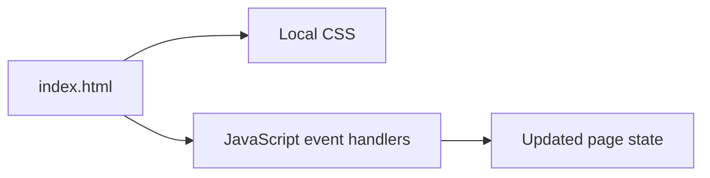

# JavaScript Mini Projects

Small browser projects for practicing DOM events, state, timers, layout, and API requests with HTML, CSS, and JavaScript.

## What you can explore

The repository name is `10-javascript-projects`; the current tree contains the following project folders:

| Project | Main concept |
| --- | --- |
| [Guess Number](Guess_Number/index.html) | Input and game state |
| [Random Joke Generator](Random%20Joke%20Generator/index.html) | Fetching and displaying a joke |
| [Snake Game](Snake_Game/index.html) | Keyboard interaction and a game loop |
| [Countdown Timer](countdown_timer/index.html) | Time calculations and periodic updates |
| [Counter](counterApp/index.html) | Button events and numeric state |
| [Modal Window](modal_window/index.html) | Opening and closing an overlay |
| [Movie Seat Booking](movie_seat_Booking/index.html) | Seat selection, totals, and local storage |
| [Quiz](quiz/index.html) | Questions, answers, and score state |
| [Conference Page](conference/index.html) | Static event-page layout |

## Run an example

Download and extract the repository, then open a project's `index.html` in a browser. No npm install or build step is provided.

For a local HTTP server, run from the repository root with Python 3 installed:

```bash
python3 -m http.server 8000
```

Open `http://localhost:8000` and select a project folder. The joke generator also needs access to its configured external joke API.

## How the examples are organized



Each project is independent. Most pair an HTML entry point with their own CSS and JavaScript; assets stay beside the example that uses them.

## Suggested exercise

Open the movie-seat example, select seats, and inspect how the displayed count and total change. Then read its script to trace how selection is stored. Small, visible interactions make this collection useful for understanding browser behavior before adding a framework.

## Scope

These are learning exercises, not a shared application or an actual booking service. API availability and fixed dates in individual examples may need updating. Preserve each project's independence when contributing a change.
